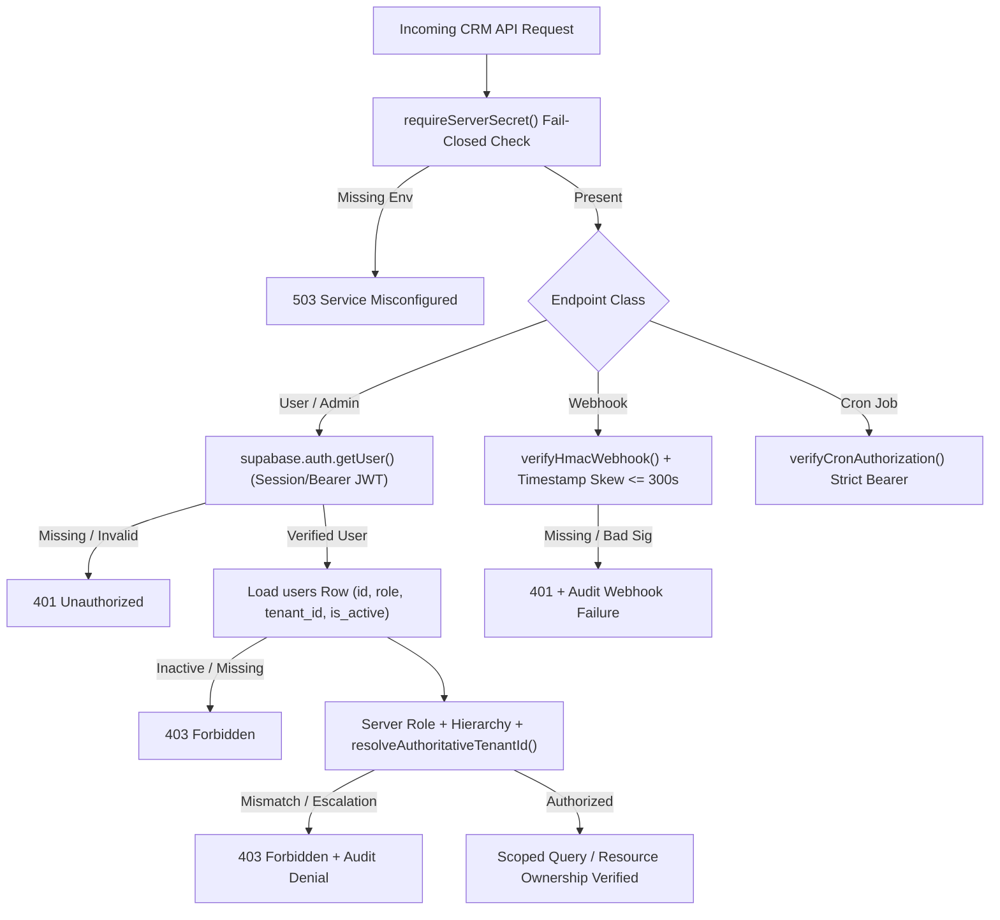

# AUTHENTICATION & AUTHORIZATION STANDARD

**Phase:** 23.1 (Section 10 Reusable CRM Security Standard)  
**Reference Implementation:** [`docs/phase23_1/evidence/remediation/crm_security_guard_reference.ts`](./evidence/remediation/crm_security_guard_reference.ts)

---

## 1. Security Request Lifecycle Architecture

---

## 2. Mandatory Enforcement Rules Across All 51 CRM Endpoints

1. **Middleware Cannot Remain Global Bypass:** Update `CRM/middleware.ts:6-12` so `/api/*` bypasses ONLY explicit signed/public webhooks (`/api/webhooks/*`, `/api/payments/razorpay/webhook`, `/api/cron/*`, `/api/mobile/login`), while `/api/admin/*`, `/api/telecaller/*`, `/api/notifications/*`, `/api/leads/*`, and internal APIs require valid session context before handler execution (plus defense-in-depth inside each handler).
2. **Never Trust Client-Supplied Authorization Claims:**
   - Discard `body.currentUserId`, `body.tenant_id`, `body.agent_id`, and `user.user_metadata.role` (`notifications/send` L50 & `007` `is_admin()` L15).
   - Always resolve `{ id, role, tenant_id, is_active }` directly from `public.users` where `id = user.id`.
3. **Strict Role Hierarchy (`assertCanGrantRole`):**
   - `super_admin` is the ONLY role authorized to create or promote `super_admin` or target cross-tenant organizations.
   - `tenant_admin` / `owner` / `admin` are strictly restricted to their verified `tenant_id` and blocked from creating/promoting `super_admin`.
4. **Fail-Closed Database & Secret Clients:**
   - Replace `lib/supabase/server.ts:27-36` dummy Proxy mock client and `"https://placeholder-project.supabase.co"` fallbacks with fail-closed startup/handler assertions (`requireServerSecret`).
5. **Standardized Safe Errors & Headers:**
   - Return `401` / `403` / `429` / `503` without raw stack traces, internal SQL messages, or token prefixes (remediates `/api/debug/daily-report` leak).
