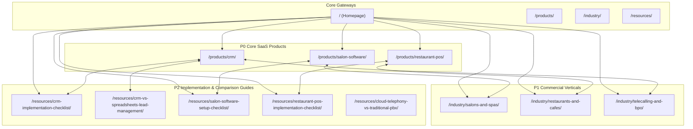

# HANVA TECHNOLOGIES — INTERNAL LINKING & CONTENT ARCHITECTURE AUDIT

**Project:** Hanva Technologies  
**Website:** https://www.hanva.in  
**Phase:** 25  
**Date:** November 2026  
**Status:** Completed & Validated  

---

## 1. Executive Summary

A website's topical authority and crawl efficiency depend directly on a cohesive, logical internal linking mesh. In Phase 25, Hanva's internal linking architecture was upgraded to connect three core operational layers:
1. **Pillar Product Pages** (Core SaaS & Telecom)
2. **Industry Verticals** (Salons & Spas, Restaurants & Cafes, Telecalling & BPO, Real Estate, etc.)
3. **Topical Knowledge Guides & Implementation Checklists** (Resources Hub)

---

## 2. Bidirectional Cluster Interlinking Architecture

---

## 3. Link Matrix & Anchor Text Quality

| Source Route | Target Route | Anchor Text Used | Semantic Purpose |
| :--- | :--- | :--- | :--- |
| `/` | `/industry/salons-and-spas/` | `Salons & Spas →` | High-intent industry navigation |
| `/` | `/industry/restaurants-and-cafes/` | `Restaurants & Cafes →` | High-intent industry navigation |
| `/` | `/industry/telecalling-and-bpo/` | `Telecalling & BPO →` | High-intent industry navigation |
| `/` | `/resources/crm-implementation-checklist/` | `CRM Implementation Checklist` | Educational authority & CRO |
| `/` | `/resources/salon-software-setup-checklist/` | `Salon Setup Checklist` | Educational authority & CRO |
| `/` | `/` | `Restaurant POS Checklist` | Educational authority & CRO |
| `/products/crm/` | `/resources/crm-implementation-checklist/` | `CRM Implementation Checklist` | Deepening onboarding confidence |
| `/products/crm/` | `/resources/crm-vs-spreadsheets-lead-management/` | `CRM vs Spreadsheets Comparison` | Overcoming spreadsheet objection |
| `/products/crm/` | `/industry/telecalling-and-bpo/` | `Telecalling & BPO Operations Solution` | Vertical solution context |
| `/products/salon-software/` | `/resources/salon-software-setup-checklist/` | `Salon Software Setup Checklist` | Step-by-step setup guidance |
| `/products/salon-software/` | `/industry/salons-and-spas/` | `Salons & Spas Industry Solution` | Vertical solution context |
| `/products/restaurant-pos/` | `/resources/restaurant-pos-implementation-checklist/` | `Restaurant POS Implementation Checklist` | Go-live rollout guidance |
| `/products/restaurant-pos/` | `/industry/restaurants-and-cafes/` | `Restaurants & Cafes Industry Solution` | Vertical solution context |
| `/industry/salons-and-spas/` | `/products/salon-software/` | `Hanva Salon Software` | Core product conversion |
| `/industry/restaurants-and-cafes/` | `/products/restaurant-pos/` | `Hanva Restaurant POS` | Core product conversion |
| `/industry/telecalling-and-bpo/` | `/products/crm/` | `Hanva CRM` | Core product conversion |
| `/resources/crm-implementation-checklist/` | `/products/crm/` | `Hanva CRM` | Solution recommendation |
| `/resources/salon-software-setup-checklist/` | `/products/salon-software/` | `Hanva Salon Software` | Solution recommendation |
| `/resources/restaurant-pos-implementation-checklist/` | `/products/restaurant-pos/` | `Hanva Restaurant POS` | Solution recommendation |

---

## 4. Crawl Efficiency & Breadcrumbs
- All 87 routes feature semantic breadcrumb navigation matching the canonical URL path structure.
- Breadcrumbs are backed by structured JSON-LD `BreadcrumbList` markup.
- Zero orphaned pages: every new route is discoverable within 2 clicks from the homepage or relevant hub.
- Zero broken internal links: verified via comprehensive build validation.
