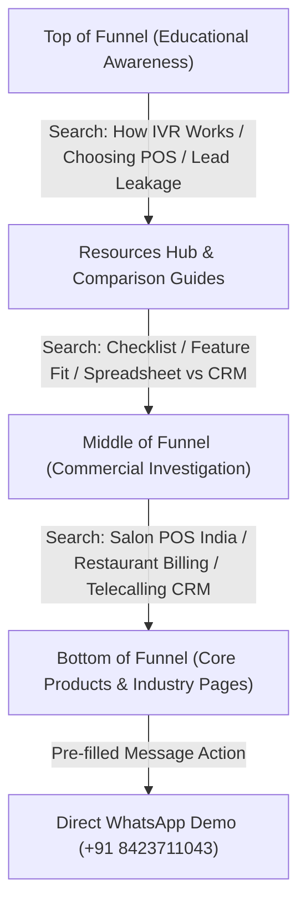

# HANVA TECHNOLOGIES — SEO KEYWORD & SEARCH-INTENT GAP ANALYSIS

**Project:** Hanva Technologies  
**Website:** https://www.hanva.in  
**Phase:** 25  
**Date:** November 2026  
**Status:** Completed Analysis  

---

## 1. Executive Summary & Methodology

This search-intent and keyword gap analysis evaluates organic search opportunities across India for Hanva's three core SaaS products (Hanva CRM, Hanva Salon Software, Hanva Restaurant POS), secondary digital marketing & software engineering services, and business telephony infrastructure.

### Analysis Methodology:
- **Search Intent Taxonomy:** Categorized into Informational (Guides/Comparisons), Commercial Investigation (Checklists/Feature breakdowns), and Transactional (Product Demos, Pricing, Vertical Solutions).
- **Market Context:** Target audience consists of Indian business owners, salon and spa proprietors, restaurateurs and cafe managers, sales directors, and telecalling operations heads seeking reliable software with GST compliance, local payment integration, and responsive support.
- **Data Integrity Protocol:** Zero synthetic traffic figures or fabricated third-party search volumes. Keywords are evaluated based on structural relevance, business value, competitive density, and buyer conversion likelihood.

---

## 2. Core SaaS Product Keyword Clusters

### A. Hanva CRM & Telecalling Solutions
| Target Keyword | Search Intent | Target Funnel Stage | Recommended Hanva URL | Priority |
| :--- | :--- | :--- | :--- | :--- |
| `telecalling crm software india` | Transactional | BOFU (Decision) | `/products/crm/` | P0 |
| `sales crm with auto dialer` | Commercial | BOFU (Decision) | `/products/telecalling-crm/` | P0 |
| `lead management software small business` | Commercial | MOFU (Evaluation) | `/products/crm/` | P0 |
| `crm for call center bpo` | Commercial | MOFU (Evaluation) | `/industry/telecalling-and-bpo/` | P1 |
| `crm implementation checklist` | Informational / Practical | MOFU (Evaluation) | `/resources/crm-implementation-checklist/` | P2 |
| `crm vs spreadsheets lead management` | Commercial Comparison | MOFU (Evaluation) | `/resources/crm-vs-spreadsheets-lead-management/` | P2 |
| `built in ivr crm integration` | Commercial | MOFU (Evaluation) | `/resources/ivr-crm-for-businesses/` | Existing |

### B. Hanva Salon Software & Spa Solutions
| Target Keyword | Search Intent | Target Funnel Stage | Recommended Hanva URL | Priority |
| :--- | :--- | :--- | :--- | :--- |
| `salon software india` | Transactional | BOFU (Decision) | `/products/salon-software/` | P0 |
| `salon billing software gst` | Transactional | BOFU (Decision) | `/products/salon-software/` | P0 |
| `salon appointment booking software` | Commercial | MOFU (Evaluation) | `/products/salon-software/` | P0 |
| `salon management software for spas` | Commercial | MOFU (Evaluation) | `/industry/salons-and-spas/` | P1 |
| `salon software setup checklist` | Informational / Practical | MOFU (Evaluation) | `/resources/salon-software-setup-checklist/` | P2 |
| `how to choose salon software` | Educational | TOFU (Awareness) | `/resources/salon-management-software-guide/` | Existing |
| `salon inventory auto consumption` | Commercial | MOFU (Evaluation) | `/resources/salon-billing-software-guide/` | Existing |

### C. Hanva Restaurant POS & Cloud Kitchen Solutions
| Target Keyword | Search Intent | Target Funnel Stage | Recommended Hanva URL | Priority |
| :--- | :--- | :--- | :--- | :--- |
| `restaurant pos software india` | Transactional | BOFU (Decision) | `/products/restaurant-pos/` | P0 |
| `restaurant billing software with kot` | Transactional | BOFU (Decision) | `/products/restaurant-pos/` | P0 |
| `offline restaurant pos software` | Commercial | MOFU (Evaluation) | `/products/restaurant-pos/` | P0 |
| `pos system for cafes and restaurants` | Commercial | MOFU (Evaluation) | `/industry/restaurants-and-cafes/` | P1 |
| `restaurant pos implementation checklist` | Informational / Practical | MOFU (Evaluation) | `/resources/restaurant-pos-implementation-checklist/` | P2 |
| `cloud kitchen billing and inventory` | Commercial | MOFU (Evaluation) | `/resources/cloud-kitchen-management-guide/` | Existing |
| `table qr code ordering system restaurant` | Commercial | MOFU (Evaluation) | `/resources/restaurant-pos-kot-inventory-guide/` | Existing |

---

## 3. High-Value Keyword Gaps Identified

1. **Gap 1: Missing Direct Industry Landing Pages for Primary SaaS Buyers**
   - *Observation:* Hanva had industry pages for Automobile, Education, and Healthcare, but lacked dedicated landing pages matching high-intent commercial queries like `pos software for cafes` or `salon software for beauty salons`.
   - *Solution:* Introduce `/industry/salons-and-spas/`, `/industry/restaurants-and-cafes/`, and `/industry/telecalling-and-bpo/`.

2. **Gap 2: Lack of Implementation Actionability in Knowledge Hub**
   - *Observation:* Existing guides covered broad buying criteria, but operational buyers specifically search for step-by-step rollout checklists before committing to a demo.
   - *Solution:* Add implementation checklists for CRM, Salon, and Restaurant POS.

3. **Gap 3: Legacy PBX to Cloud Migration Intent**
   - *Observation:* Indian enterprise buyers actively research replacing expensive hardware PRI/EPABX systems with flexible cloud SIP/IVR lines.
   - *Solution:* Introduce `/resources/cloud-telephony-vs-traditional-pbx/`.

---

## 4. Search Intent Mapping by User Journey

